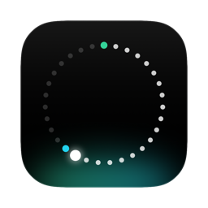

<div align="center">



# Tally

**A calm little Mac app for your monthly money.**<br>
Open it for two seconds and you know what you can spend today, what's still to pay,<br>
and when your emergency fund will be full.

[](https://github.com/GjinPrelvukaj/tally/actions/workflows/tests.yml)
[](https://github.com/GjinPrelvukaj/tally/releases/latest)
[](#download)
[](Package.swift)
[](LICENSE)
<br>
[](#private-by-design)
[](Package.swift)
[](#download)

<br>

[](https://github.com/GjinPrelvukaj/tally/releases/latest/download/Tally.dmg)

<br>


<sub>Screenshots use made-up example data.</sub>

</div>

<br>

## What it does

<table>
<tr>
<td width="50%" valign="top">

### ☀️ Today
One number: what you can spend each day until your next pay. Money that's already promised (rent, a bill, a
transfer to savings) is never counted as spendable. Below it, what's still to pay; click a row once it's paid.

</td>
<td width="50%" valign="top">

### 🫙 Pots
Each account as a tube of light: your main account, a clothes pot, an emergency fund with its goal and the
month you'll reach it, and what you owe on the card. When pay arrives, one click splits it and you watch it pour.

</td>
</tr>
<tr>
<td valign="top">

### 📈 Month
Your main account as a line through the month: solid for what happened, dashed for what's planned, the lowest
point marked. Scroll back through every month since you started.

</td>
<td valign="top">

### 🗓️ Plan
What comes in, what goes to savings, what goes out. On a day, in a window of days, any day or "when the salary
arrives"; every month, every few months or once a year. Unpaid items carry over instead of disappearing.

</td>
</tr>
<tr>
<td valign="top">

### ✨ Insights
Running short before payday, a pace faster than the plan, small spends that add up, a category up on last
month, a card owing more each month. Every one worked out exactly, on your Mac.

</td>
<td valign="top">

### 👥 People
What anyone owes you, or you owe them: money lent or borrowed, paid back either way, or owed from before you
started. Share a spend with your partner and Tally keeps what they owe you.

</td>
</tr>
</table>

**Log a spend** in a couple of seconds: an amount, a category, bank card, credit card or cash, done. Any entry can
be changed or deleted later, and the last thing you recorded can be undone.

**Ask Tally.** On a Mac with Apple Intelligence you can ask things like *"what did I spend on coffee with Sam this
month?"*. The on-device model only reads the question; Tally answers it from your data, never from the model.

<p align="center">
  
  
  
  
</p>

## Your own plan from the first minute

On first launch Tally asks a few questions: what comes in, what you pay regularly, what you put aside, what's in
each account right now and what's already paid this month. It makes your plan from the answers, and all of it can
be changed later.

<p align="center">
  
</p>

## Private by design

|  |  |
|---|---|
| 🔒 **Nothing leaves your Mac** | No account, no network access, no analytics. Your data is one file: `~/Library/Application Support/Budget/Budget.store` |
| 👆 **Touch ID** | Tally can lock behind Touch ID, on opening and again when the Mac sleeps. |
| 🫥 **Hide every amount** | Click a big number, the eye or press ⇧⌘H when someone is looking; or have amounts start hidden. |
| 🧩 **No third-party code** | Swift, SwiftUI and SwiftData only. Read every line of it here. |

## Keyboard

| Keys | Does |
|---|---|
| <kbd>⌘</kbd> <kbd>N</kbd> | Log a spend |
| <kbd>⌘</kbd> <kbd>1</kbd> … <kbd>7</kbd> | Today, Pots, Month, Insights, Entries, Plan, People |
| <kbd>⌘</kbd> <kbd>,</kbd> | Settings |
| <kbd>⌘</kbd> <kbd>Z</kbd> | Undo the last thing recorded |
| <kbd>⇧</kbd> <kbd>⌘</kbd> <kbd>H</kbd> | Hide or show every amount |
| <kbd>⌘</kbd> <kbd>←</kbd> / <kbd>⌘</kbd> <kbd>→</kbd> | Earlier or later month, on Month |

## Download

Get **[Tally.dmg](https://github.com/GjinPrelvukaj/tally/releases/latest/download/Tally.dmg)** from the
[latest release](https://github.com/GjinPrelvukaj/tally/releases/latest), open it and drag Tally onto Applications.
Needs **macOS 26** or later. Signed and notarized by Apple.

## Build it yourself

Needs macOS 26 and Xcode 26 (Swift 6). No third-party packages.

```bash
swift test                                                  # the tests
Scripts/make-app.sh release                                 # builds build/Tally.app
build/Tally.app/Contents/MacOS/Tally --demo --screen pots   # made-up example data, never your own
```

[CONTEXT.md](CONTEXT.md) explains how the money is worked out and where everything lives;
[AGENTS.md](AGENTS.md) is how to work on it.

## Licence

[GNU GPL v3](LICENSE) © 2026 Gjin Prelvukaj. You can use, study, change and share Tally, but anything you build
from it and share must also be open source under the GPL v3.
