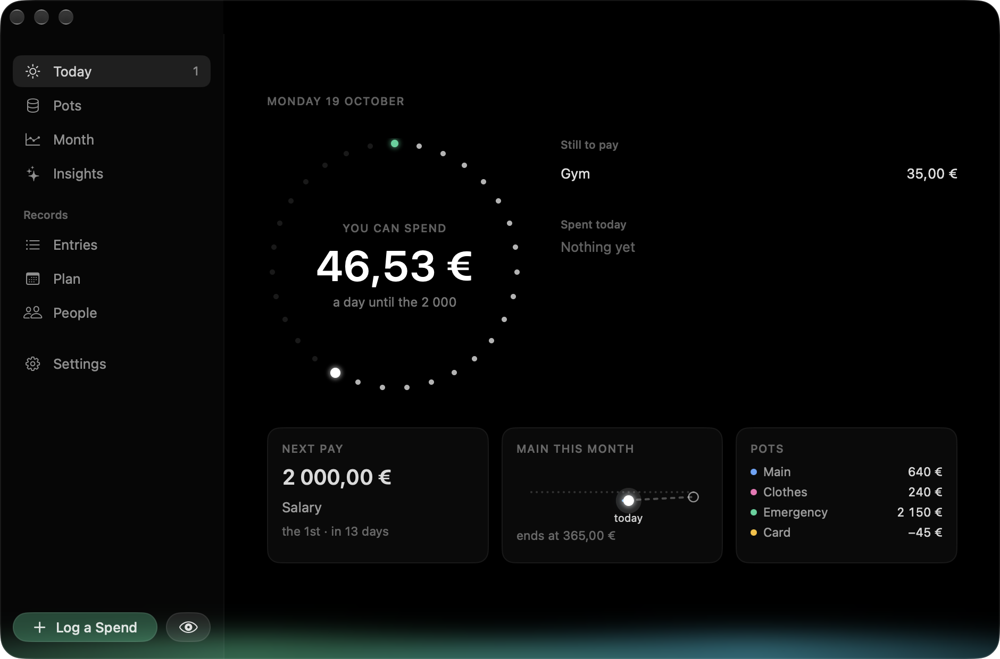
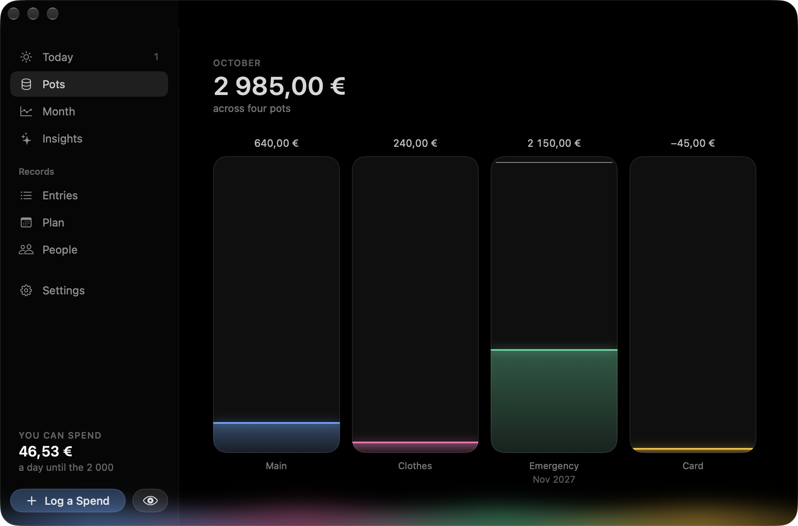
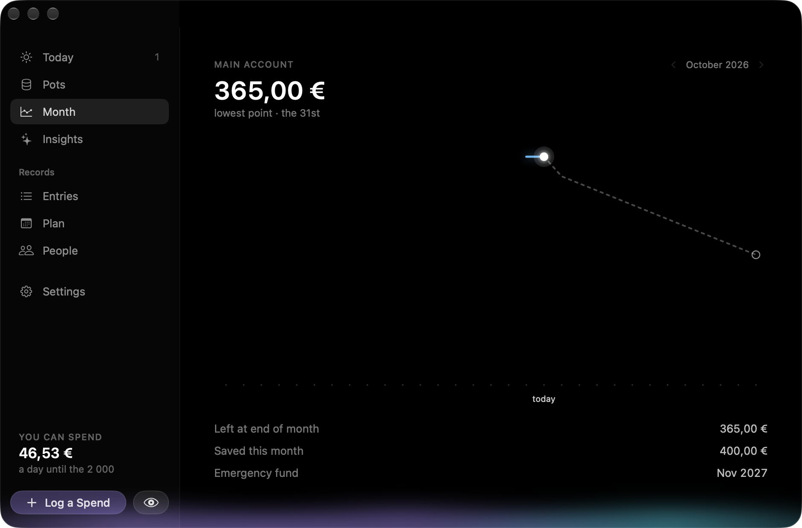
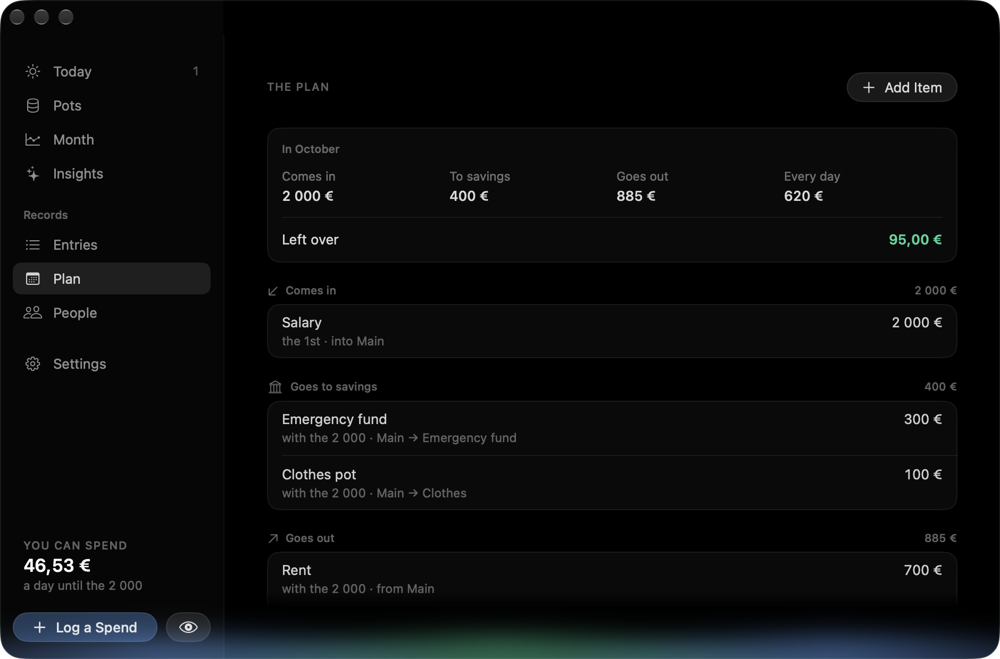
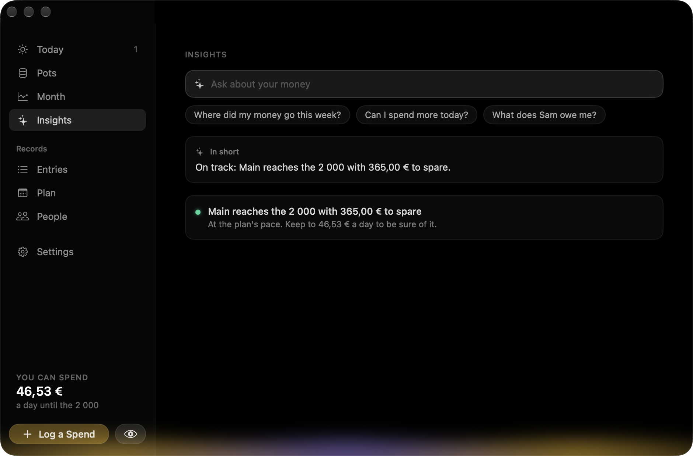
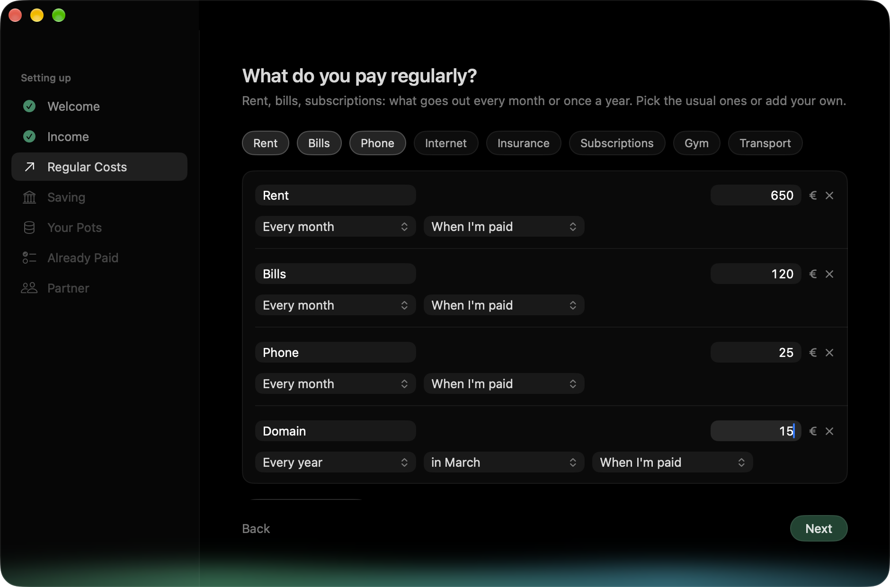

# Tally

**A calm little Mac app for your monthly money.** Open it for two seconds and you know what you can spend
today, what's still to pay this month, and when your emergency fund will be full.

<p>
  
  
  
  
  
  
</p>

<sub>Screenshots use made-up example data.</sub>

## What it does

- **Today** shows one number: what you can spend each day until your next pay. Money that's already promised
  (rent, a bill, a transfer to savings) is never counted as spendable. Below it, what's still to pay this month;
  click a row when you've paid it.
- **Pots** shows each account as a tube of light: your main account, a savings pot, an emergency fund with its
  goal and the month you'll reach it, and what you owe on a card. When pay arrives, one click splits it as planned
  and you watch it pour into the pots.
- **Month** draws your main account as a line through the month: solid for what happened, dashed for what's
  planned, with the lowest point marked. Scroll back through past months.
- **Your plan** is a list of what happens every month: what comes in, what goes to savings, what goes out.
  Things can happen on a day, in a window of days ("between the 15th and 20th"), any day, or "when the salary
  arrives", and every month, every few months or once a year (a domain, an insurance). Unpaid items carry over to
  the next month instead of quietly disappearing.
- **Log a spend** in a couple of seconds (⌘N): an amount, a category, paid by bank card, credit card or cash, done.
  Shared with your partner? Say so, and Tally keeps what they owe you. ⌘Z undoes the last thing you recorded.

A sidebar takes you between Today, Pots, Month, Insights, your entries, the plan and People (⌘1–⌘7). People keeps what anyone owes you, or you owe them: money you lent or borrowed, paid back either way, or owed from before you started. Insights points out what needs a look: running short before payday, a pace faster than the plan, small spends that add up, a category up on last month, a spend that comes every month but isn't planned, a card owing more each month, and what your partner owes you; every one worked out exactly on your Mac. On a Mac with Apple Intelligence you can also ask it things ("what did I spend on coffee with Sam this month?"): the on-device model only reads the question, and Tally answers from your data. Every screen grows with the window, from a small one to full screen. An entry or a plan item opens beside its list; Log a Spend and payday open as a card in the middle, over the blurred window; pull it down or click away to close it.

## Private by design

Tally has no account, no network access and no analytics. Your data is a single file on your Mac
(`~/Library/Application Support/Budget/Budget.store`) and never leaves it. In Settings (⌘,) it can lock behind
Touch ID, and every amount can be hidden at once (and start hidden when Tally opens) (click a big number, the eye, or press ⇧⌘H) when someone is looking.

## Download

Get the latest **Tally.dmg** from [Releases](https://github.com/GjinPrelvukaj/tally/releases/latest), open it and
drag Tally to Applications. Needs **macOS 26** or later. Signed and notarized by Apple.

On first launch Tally asks a few questions (your income, what you pay regularly, what you put aside, what's in each
account right now) and makes your own plan from the answers. All of it can be changed later in the Plan.

## Build it yourself

Needs macOS 26 and Xcode 26 (Swift 6). No third-party packages.

```bash
swift test                     # the tests
Scripts/make-app.sh release    # builds build/Tally.app
build/Tally.app/Contents/MacOS/Tally --demo --screen pots   # made-up example data, never your own
```

[CONTEXT.md](CONTEXT.md) explains how the money is worked out and where everything lives;
[AGENTS.md](AGENTS.md) is how to work on it.

## Licence

[GNU GPL v3](LICENSE) © 2026 Gjin Prelvukaj. You can use, study, change and share Tally, but anything you
build from it and share must also be open source under the GPL v3.
